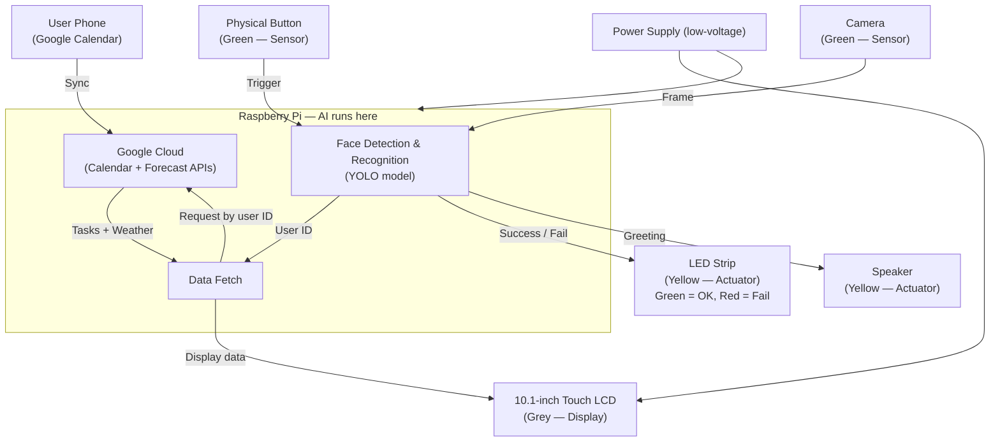

# Project Definition (PD) — P1 CTAI

Fill in every table below, just like you did with the real PD.

---

## 1. Project identity

| Field                | Your answer                                      |
| -------------------- | ------------------------------------------------ |
| **Working title**    | SmartMirror – Morning Assistant                  |
| **Student name**     | Dominik Proksa                                   |
| **Sparring partner** | Michal Heles                                     |
| **Project type**     | [x] Vision [ ] Keypoint detection [ ] Non-visual |

---

## 2. Concept & impact

| Topic            | Your answer                                                                                                                                                                                                                    |
| ---------------- | ------------------------------------------------------------------------------------------------------------------------------------------------------------------------------------------------------------------------------ |
| **Objective**    | Develop a working AI prototype for people who don't want to reach for their phone on busy mornings, so they have all the information to start their day on the mirror, and for people who want to schedule tasks and make a to-do list for every day. |
| **Target group** | Busy people, students, and families with hectic morning routines who need quick access to personalised daily info without grabbing their phone.                                                                                 |
| **Core problem** | On rushed mornings, people fumble for phones to check time, weather, calendar, and tasks, breaking their morning flow and wasting precious minutes.                                                                             |
| **Key question** | How can a smart mirror help people have quicker, more efficient mornings?                                                                                                                                                       |
| **Impact**       | Makes mornings faster with quick, hands-free info (saves 10–15 min daily) and reduces unnecessary phone use.                                                                                                                   |

---

## 3. AI & data pipeline

### 3A. Method & data

> **Note:** Standard **image classification only** (single label per image, no boxes/keypoints) is **not allowed**.

| Requirement                    | Your answer                                                                                                                    |
| ------------------------------ | ------------------------------------------------------------------------------------------------------------------------------ |
| **Dataset — how & where**      | Own photos: scan each person's face using the onboard camera — no copyrighted or pre-labelled datasets used.                   |
| **Classes (min. 4, target 6)** | 1. Dominik 2. Classmate/friend 2 3. Classmate/friend 3 4. Classmate/friend 4 5. Classmate/friend 5 6. Classmate/friend 6     |
| **Volume**                     | [x] ≥ 100 annotations **per class** planned — ~100 photos per person × 6 persons = ~600 images total                         |

| Class name       | Planned # samples / annotations |
| ---------------- | ------------------------------- |
| Person 1 (Dominik Proksa) | ≥ 100                  |
| Person 2         | ≥ 100                           |
| Person 3         | ≥ 100                           |
| Person 4         | ≥ 100                           |
| Person 5         | ≥ 100                           |
| Person 6         | ≥ 100                           |

### 3B. Training & export

| Project type           | Your choice & model                                                          |
| ---------------------- | ---------------------------------------------------------------------------- |
| **Vision**             | Recent **YOLO** model trained in Python — YOLO (face detection & recognition) |
| **Keypoint detection** | Pretrained **MediaPipe** (or similar) → custom classifier on top — describe: |
| **Non-visual**         | Model / approach:                                                            |

| Topic                    | Your answer                                                                                                          |
| ------------------------ | -------------------------------------------------------------------------------------------------------------------- |
| **Model information**    | YOLO-based face detection & recognition model; scans for a face and identifies who it is (6 classes); exported as `.pt` |
| **Training environment** | [x] Laptop — trained locally, model deployed to Raspberry Pi                                                         |
| **Export to RPi**        | Trained model weights copied to `RPi/ai/`; Raspberry Pi runs inference in real time                                  |

---

## 4. Hardware & Makerlab plan

### 4A. Mandatory hardware

| Requirement                       | Your implementation                                                                                                                   |
| --------------------------------- | ------------------------------------------------------------------------------------------------------------------------------------- |
| **Headless-first**                | [x] Both — physical button triggers face scan/system wake; Gradio allows remote management via phone                                 |
| **Visual feedback (mandatory)**   | 10.1-inch HDMI touch LCD — shows to-do list, time, weather, and status icons                                                         |
| **Hardware feedback (mandatory)** | LED strip: lights green on successful face recognition, red on failure; speaker plays voice messages (Good morning, Good evening, …)  |
| **Extra sensor or actuator**      | Physical button — triggers face scan / system wake; starts or stops the recognition loop                                             |

### 4B. Build quality (Makerlab)

| Criterion            | Your plan                                                                                                 |
| -------------------- | --------------------------------------------------------------------------------------------------------- |
| **Housing**          | Laser-cut wooden frame with acrylic one-way mirror insert                                                 |
| **Cable management** | All USB, HDMI, and power cables routed through back panel cable glands; no exposed wiring on the front    |
| **Safety**           | Low-voltage only; no exposed electronics; all connectors recessed in back panel                           |
| **Aesthetics**       | Matte black wood finish, flush glass, hidden cables, LED accent lighting for a modern smart-home aesthetic |

---

## 5. Software & visualisation

### 5A. Gradio interface (mandatory pages)

| Page                   | Content you will show                                                                                |
| ---------------------- | ---------------------------------------------------------------------------------------------------- |
| **About & onboarding** | Explains what the mirror does, how it works, and how to add yourself as a recognised user            |
| **Data**               | Shows detected user, live weather forecast, current to-do list, and recognition logs                 |
| **Operating**          | Lets the user manage the to-do list manually; syncs with Google Calendar                             |
| **Debugging**          | GPIO toggle for LEDs (camera test), model test, database check, and display diagnostics              |

| **Link to kickoff codebase** | [https://github.com/howest-mct/2025-26-projectone-ctai-ProksaDominik](https://github.com/howest-mct/2025-26-projectone-ctai-ProksaDominik) |
| ---------------------------- | ----------------------------------------------------------------------------------------------------------------------------------------- |
| **Extra pages (optional)**   |                                                                                                                                           |

### 5B. Backend & data

| Component    | Your answer                                                                                                                                                                |
| ------------ | -------------------------------------------------------------------------------------------------------------------------------------------------------------------------- |
| **Database** | Stores: user profiles (name & ID), face model/label per user, to-do list tasks per user, recognition logs (who/when), display & refresh settings. Synced to Google Cloud. |
| **Docker**   | [ ] Yes — compose file location: [x] No — justification: single Raspberry Pi deployment, no containerisation needed                                                        |
| **API**      | Gradio + Google Calendar API (to-do list sync) + Google Forecast API (live weather); Raspberry Pi requests data from Google APIs per detected user ID                      |

---

## 6. System architecture (block diagram)

Paste your diagram below (image or Mermaid). Use these **colours**:

| Colour | Meaning                                  |
| ------ | ---------------------------------------- |
| Red    | Microcontroller (Raspberry Pi) or laptop |
| Green  | Sensors                                  |
| Yellow | Actuators                                |
| Grey   | Display                                  |
| Blue   | Power supply                             |

**Also label:** where AI runs (Pi vs laptop) and what each model does.

